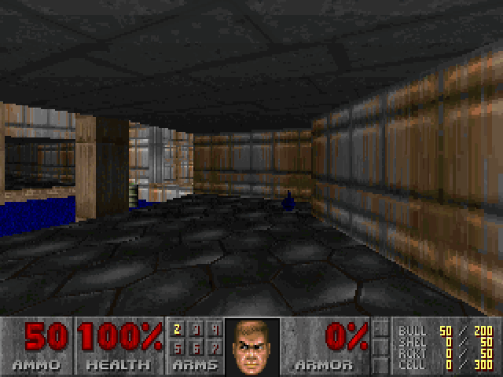

# DOOM on EVM

DOOM gameplay and rendering, ported from the original C to Solidity and executed
inside a local Ethereum Virtual Machine. Movement, monsters, weapons, collision,
visibility and pixels all run in the EVM. The browser sends keys and displays
the result.

An unnecessarily expensive way to run DOOM. Built for fun; checked against the
original C with considerable seriousness.

<a href="docs/media/README.md"></a>

*Five seconds of Ultimate DOOM's Hangar, from an existing verified EVM recording.
Playback follows game time, not real-time EVM performance.
[Recording provenance](docs/media/README.md).*

[Play locally](#quick-start) · [Architecture](docs/ARCHITECTURE.md) ·
[Compatibility](docs/COMPATIBILITY.md) · [Documentation](docs/README.md)

## A few measured consequences

The separate, accepted **nine-map Ultimate DOOM Episode One recording suite** produced:

| Measurement | Result |
|---|---:|
| EVM-generated frames | 18,175 |
| Complete indexed framebuffers equal to the declared native profile | 18,173 |
| Gas, including recording/observation transactions | 18,947,598,824,099 |
| Frames per summed rendering-RPC second | 1.094161 |

The videos are encoded at **35 FPS**. Computing them was slower. Two frames have
declared virtual-pointer-derived differences; matching values elsewhere do not
prove native pointer equality. These are finite, profile-bound comparisons,
not universal DOOM compatibility. [Evidence and measurement scope](docs/COMPATIBILITY.md#what-the-recording-numbers-establish).

## What you can play

| Game | Browser profile | Verification boundary |
|---|---|---|
| Freedoom 0.13.0 | Episode One, E1M1–E1M9 | Open assets; episode resources, replays and bounded UI/gameflow proofs |
| Ultimate DOOM 1.9 | Episode One, E1M1–E1M9 | Bring `DOOM.WAD`; nine standalone recordings plus browser checks |
| DOOM II 1.9 | MAP01–MAP32 selectable | Bring `DOOM2.WAD`; all-map startup, full recorded gameplay on MAP01 and MAP07 |

Menus, Status Bar/HUD, automap, keyboard cheats, supported Options, death/respawn
and six-slot **Exact EVM Snapshot** Save/Load are available. Exact snapshots
deliberately differ from original DOOM save semantics. [Full support matrix](docs/COMPATIBILITY.md).

## Quick start

Verified on **macOS arm64**. Install Git, Python 3.10+, **Node 24.11.0** and Chrome.
From a fresh checkout:

```sh
git clone --recurse-submodules https://github.com/ediskandarov/doom-evm.git
cd doom-evm
python3 scripts/install-toolchain.py
source scripts/env.sh
python3 scripts/check-toolchain.py
node tools/wad/download.ts artifacts/local/freedoom
cp artifacts/local/freedoom/freedoom1.wad web/install-assets/freedoom1.wad
```

Start a dedicated local Anvil on a free port:

```sh
.toolchain/bin/anvil --host 127.0.0.1 --port 18991 --chain-id 31337 \
  --hardfork cancun --disable-code-size-limit --no-request-size-limit \
  --memory-limit 1073741824 --gas-limit 10000000000 \
  --allow-origin http://127.0.0.1:18992
```

In another terminal, from the repository root:

```sh
python3 -m http.server 18992 --bind 127.0.0.1 --directory web
```

Open **<http://127.0.0.1:18992>**, set RPC to `http://127.0.0.1:18991`, then
**Connect → choose a game → Install / resume → Play**. The browser deploys the
included authenticated contracts and resources. No Solidity build, wallet or
private key entry is needed to play. Installation can take several minutes.

WASD/arrows move and turn, Shift runs, Ctrl fires, Space/E uses, Tab opens the
automap, Escape opens the menu. [Setup, controls and recovery](docs/browser-deployment/README.md).
For commercial games, use the [tested macOS SteamCMD setup and IWAD import guide](docs/GETTING-STARTED.md#commercial-iwads-on-macos).
Commercial IWADs are not included.

## How it works

Raw authenticated WAD resources → immutable EVM resource contracts →
original-source Solidity simulation and renderer → indexed `Frame` and
`FramePalette` logs → browser Canvas. The native C oracle is used for comparison;
its gameplay state and pixels are never production inputs.
[Architecture](docs/ARCHITECTURE.md) · [C → Solidity mapping](PORTING.md).

## Limits, deliberately visible

- **Local Anvil only:** large contracts, a 10-billion-gas budget and relaxed local
  limits. This does not run on public Ethereum or ordinary mainnet settings.
- **Restricted native fidelity:** interactive play explicitly uses experimental
  virtual-pointer policy 3. It cannot reproduce arbitrary native heap addresses
  or all undefined C behavior. Unknown/unproven memory reads still revert.
- **Partial original feature coverage:** sound, music and multiplayer are out of
  scope. Other DOOM episodes, arbitrary WADs, several original controls and
  DOOM II's MAP30 cast sequence are unsupported. Recording wipes do not imply
  production browser wipes; all-map startup does not imply all-map playthrough.

## Verification and credits

Native comparisons, receipt/frame hashes, speedrun certificates and failed
diagnostics remain reproducible at their recorded revisions. Current checks and
historical reproduction entry points are in [Development and verification](docs/DEVELOPMENT.md);
the [documentation index](docs/README.md) keeps the engineering archive accessible.

Based on id Software's original [`linuxdoom-1.10`](UPSTREAM.md), pinned to
`a77dfb96cb91780ca334d0d4cfd86957558007e0`. Code: [GPL-2.0-only](LICENSE).
Freedoom contributors provide the redistributable game assets
under their [BSD license](test/fixtures/wad/COPYING.txt).
Original demo authors and archive provenance are credited in the per-run reports.
DOOM and its commercial assets belong to their respective owners; this is an
independent hobby project.
