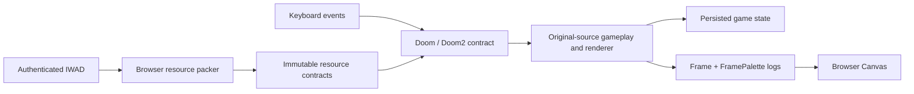

# Architecture

DOOM's simulation, visibility and indexed pixel generation execute as Solidity
inside a local EVM. The browser installs authenticated resources, submits keyboard
events, receives transaction logs and expands palette indexes into Canvas RGBA.
The native C executable is an independent comparison oracle used by tests.

## Source boundaries

| Path | Responsibility |
|---|---|
| `src/doom/` | Same-named ports of original C modules, explicit state contexts, numerical and memory adapters |
| `src/evm/Doom.sol`, `Doom2.sol` | Authenticated resources, driver/input sequencing, transactions, persistence, menus and Frame emission |
| `src/evm/EpisodeRuntime.sol` | Original ticker, UI, death/rebirth and supported level progression orchestration |
| `src/evm/DoomGame.sol`, `DoomRenderer.sol` | Cross-module gameplay and renderer calls; renderer pass order remains source-derived |
| `src/evm/ResourceStore.sol` | Ordinary CREATE of immutable resource bytecode; bounded reads authenticate ordered chunk identities |
| `web/launcher.mjs`, `install-*.mjs` | Local node admission, IWAD authentication, resumable installation and release verification |
| `web/menu-app.mjs`, `input-loop.mjs`, `protocol.mjs` | Sequenced keyboard transactions and authenticated receipt/log presentation |
| `tools/reference/`, `test/` | Original-C oracles, observation consumers, fixtures and tests; no native pixels enter production |

Directory names alone do not define deployment scope: `Doom.sol` still imports
[`UltimateStartup.sol`](../src/support/UltimateStartup.sol) from `src/support/`.
Conversely, [`f_wipe.sol`](../src/doom/f_wipe.sol) is exercised by the recording
consumer and tests, but is not wired into the production browser contracts.

## Transactions and resources

The browser verifies exact IWAD identity and packages original lump bytes. It does
not calculate visibility, pre-render frames or send native world state to the
contract. Resource chunks use STOP-prefixed immutable code; directories, ordered
runtime hashes, bundle identity and palettes are authenticated. Game startup is
atomic. See [resource schemas](SCHEMAS.md) and the [resource proof](PHASE2-SOURCE.md).

Each accepted input transaction advances a bounded number of original game tics.
The contract owns game state, input sequence and the resulting frame. A reverted
transaction contributes neither state changes nor accepted Frame output. The
browser serializes writers, reconciles receipts and rejects stale or mismatched
frames/palettes. Original 35-tic simulation timing is independent of wall-clock
transaction throughput. [Input protocol](../INPUT_PROTOCOL.md).

Installation uses ordinary CREATE transactions from an unlocked development
account on a dedicated local Anvil. IndexedDB records pending operation data,
nonce reservations and receipts; it is not the authoritative game state. Runtime
and resource checks protect recovery after reload or a lost RPC response.
[Deployment and recovery](browser-deployment/README.md).

## C memory in a transaction machine

The port keeps original control flow, fixed-width arithmetic and RNG order.
Explicit contexts replace C globals. Checked IDs/indexes replace host pointers;
the zone ledger preserves allocation order, block relationships, owner clearing
and known backing bytes where source-observable. Unsupported reads revert.

The browser explicitly selects experimental memory policy 3. Its deterministic
zone/owner-slot addresses are representations, not native process addresses.
Original allocation-dependent or undefined C behavior cannot become universal
native equivalence through that representation. See [compatibility profiles](COMPATIBILITY.md#memory-profiles).

Six-slot Exact EVM Snapshot Save/Load archives four authoritative state roots,
including allocator/render history. It deliberately differs from original DOOM's
lossy save format and deferred action timing. Slots bind engine bytecode, schema,
resources and memory policy. They persist with that local chain; a fresh Anvil
has no saved game. [Save semantics](SAVE-LOAD.md).

Compiler settings, execution limits, source mappings and native profiles are
pinned. See [development](DEVELOPMENT.md), [toolchain](../TOOLCHAIN.md) and
[C → Solidity mapping](../PORTING.md).
